<p align="center">
  
</p>

<h1 align="center">Aprova</h1>

<p align="center">
  <b>Estude para o seu concurso com método, sozinho ou com a sua turma.</b><br>
  Provas reais com gabarito, simulados, revisão no dia certo, metas da semana, PDFs marcados, grupos de estudo e ranking.<br>
  Grátis, em português e feito para quem estuda depois do trabalho.
</p>

<p align="center">
  <a href="https://github.com/NatanaelSantz/aprova/releases/latest/download/Aprova.zip"></a>
  &nbsp;
  <a href="https://natanaelsantz.github.io/aprova/"></a>
</p>

<p align="center">
  
  
  
  
  
</p>

<p align="center">
  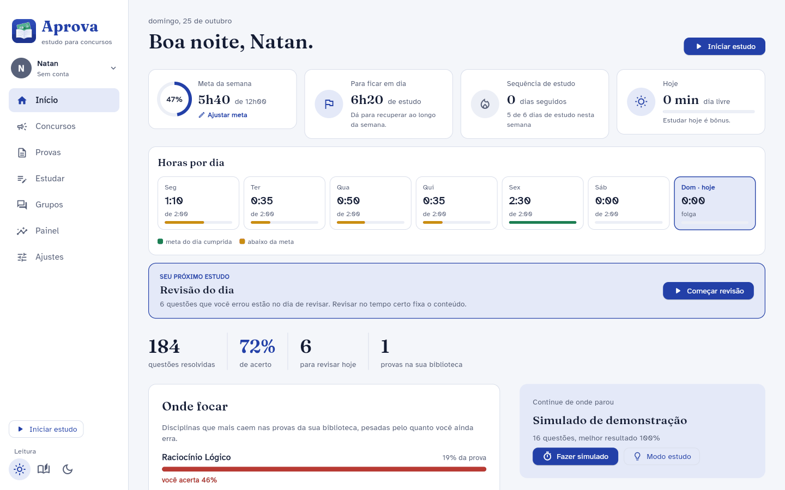
</p>

---

## O que o Aprova faz

<table>
  <tr>
    <td width="50%" valign="top">
      <h3>📄 Provas reais, prontas para resolver</h3>
      Digite o concurso (ex.: <i>Dataprev 2026</i>) e o Aprova busca nas bancas, na internet e no PCI Concursos. As provas entram com o <b>gabarito oficial</b> e abrem no próprio app, em modo simulado ou estudo.
    </td>
    <td width="50%" valign="top">
      <h3>🎯 Onde focar</h3>
      Cruza quanto cada disciplina cai nas suas provas com quanto você ainda erra. O <b>Painel</b> mostra onde você está forte e onde precisa melhorar, com a evolução das últimas semanas.
    </td>
  </tr>
  <tr>
    <td valign="top">
      <h3>⏱️ Meta da semana sem culpa</h3>
      Meta de horas por semana, cronômetro de estudo, horas por dia e o cartão <b>“Seu próximo estudo”</b>. A primeira semana conta só a partir do dia em que você começou.
    </td>
    <td valign="top">
      <h3>🔁 Revisão no dia certo</h3>
      O que você erra volta em 1, 3, 7, 15 e 30 dias até ficar dominado. Os simulados trazem primeiro as questões que você nunca fez e, no fim, comentam o resultado: o que você errou em cada matéria e o próximo passo.
    </td>
  </tr>
  <tr>
    <td valign="top">
      <h3>👥 Grupos de estudo</h3>
      Cada turma tem a sua conversa, com dúvidas, <b>fotos e arquivos do computador</b>, <b>GIFs e figurinhas</b> (até as suas do WhatsApp) e <b>planos de estudo</b> que dá para usar como meta com um clique. Quem cria o grupo modera.
    </td>
    <td valign="top">
      <h3>🔗 Convite por link</h3>
      Mande o link do grupo pelo <b>WhatsApp</b>, Telegram, e-mail, <b>Instagram</b> ou <b>TikTok</b> (imagem com QR code para os Stories). Quem abre entra no grupo com um clique, sem digitar código nem fazer cadastro.
    </td>
  </tr>
  <tr>
    <td valign="top">
      <h3>🏆 Ranking da semana</h3>
      Compare horas, questões, acerto e sequência com outras pessoas, no geral ou só com o seu grupo. No ranking aparecem só o apelido e os números.
    </td>
    <td valign="top">
      <h3>👁️ Conforto para os olhos</h3>
      Temas claro, sépia e escuro, fonte Atkinson Hyperlegible com tamanho ajustável, leitura em voz alta e lembrete de pausa 20-20-20.
    </td>
  </tr>
  <tr>
    <td valign="top">
      <h3>🖍️ Marcar PDF</h3>
      Lei seca, apostila, edital ou prova: <b>marca-texto em 4 cores</b>, sublinhado e notas. Salve um PDF novo com as marcações <b>editáveis</b> ou <b>fixas</b> (ninguém apaga nem muda). O arquivo original não é alterado.
    </td>
    <td valign="top">
      <h3>🔄 Sempre atualizado</h3>
      Toda vez que abre, o Aprova confere se saiu versão nova e <b>já abre atualizado</b>. Com o app aberto, ele baixa sozinho e avisa por notificação. Estudos, contas e PDFs marcados continuam como estão.
    </td>
  </tr>
</table>

## Telas

<table>
  <tr>
    <td width="50%">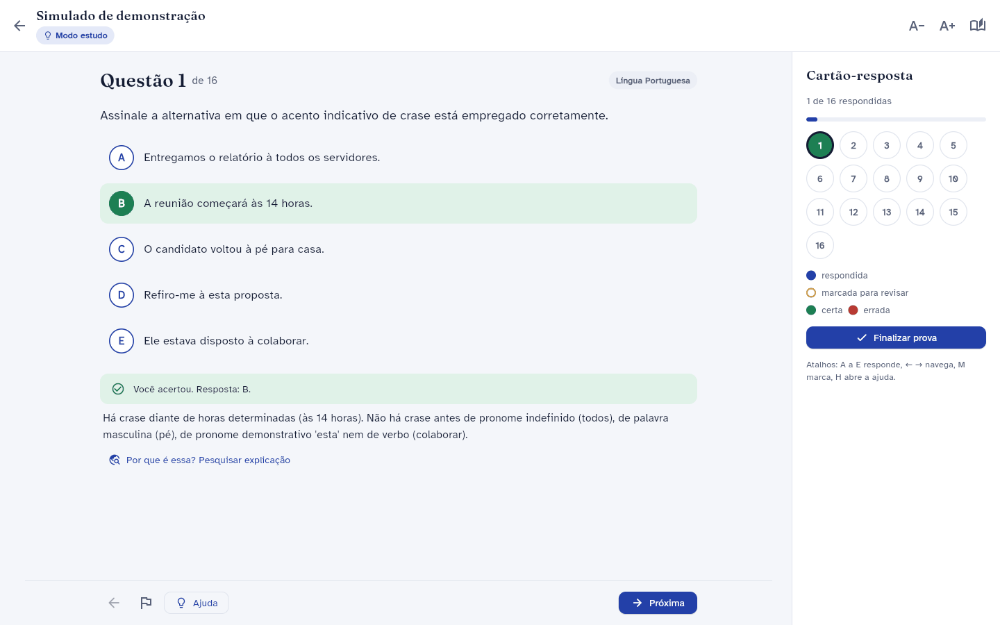<br><sub><b>Prova em modo estudo:</b> correção a cada questão e cartão-resposta.</sub></td>
    <td width="50%">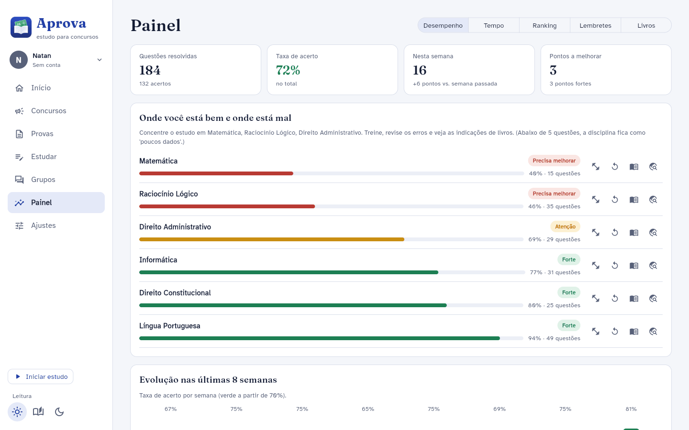<br><sub><b>Painel:</b> onde você está bem e onde precisa melhorar.</sub></td>
  </tr>
  <tr>
    <td>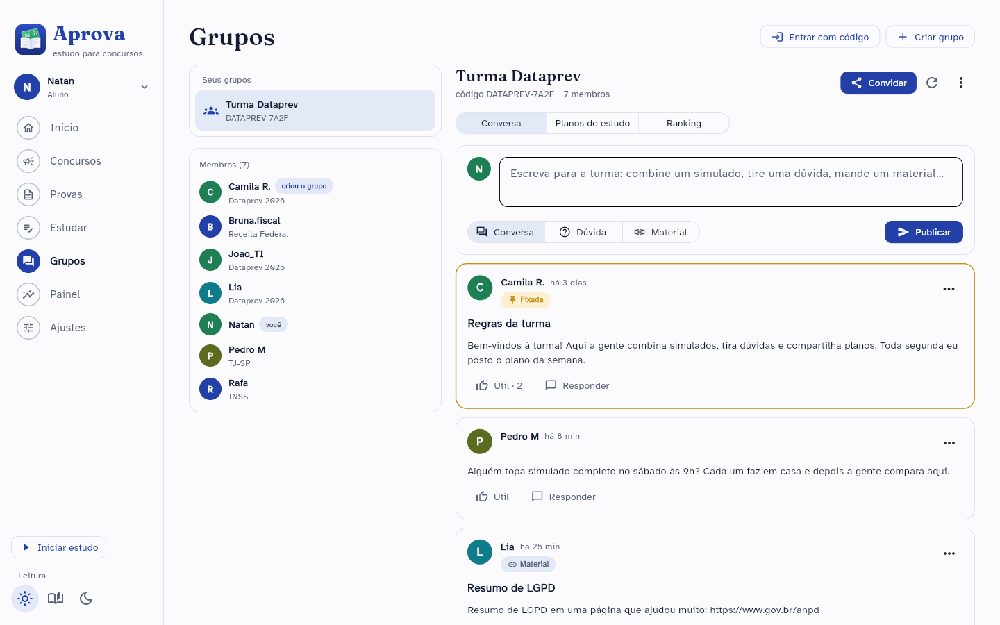<br><sub><b>Grupos:</b> conversa da turma, dúvidas e materiais.</sub></td>
    <td>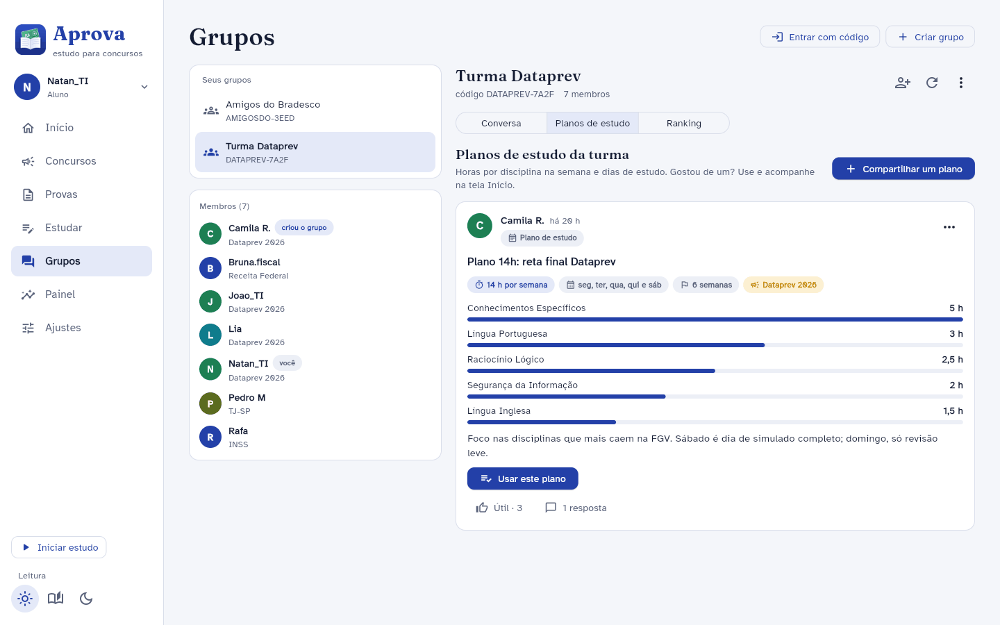<br><sub><b>Planos de estudo:</b> use o plano da turma como a sua meta.</sub></td>
  </tr>
  <tr>
    <td>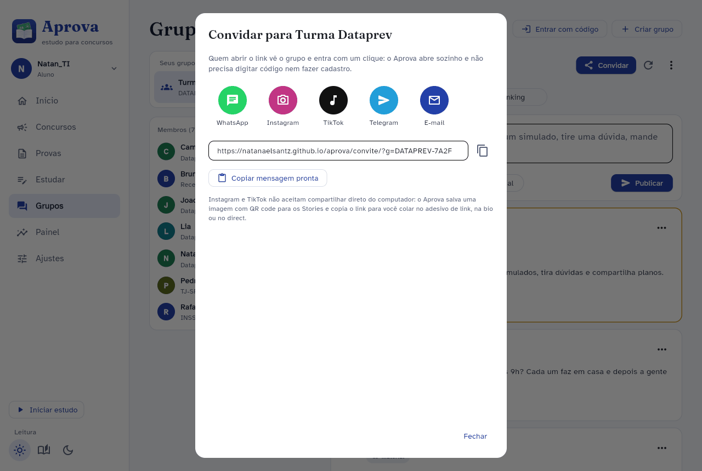<br><sub><b>Convidar:</b> WhatsApp, Instagram, TikTok, Telegram e e-mail.</sub></td>
    <td>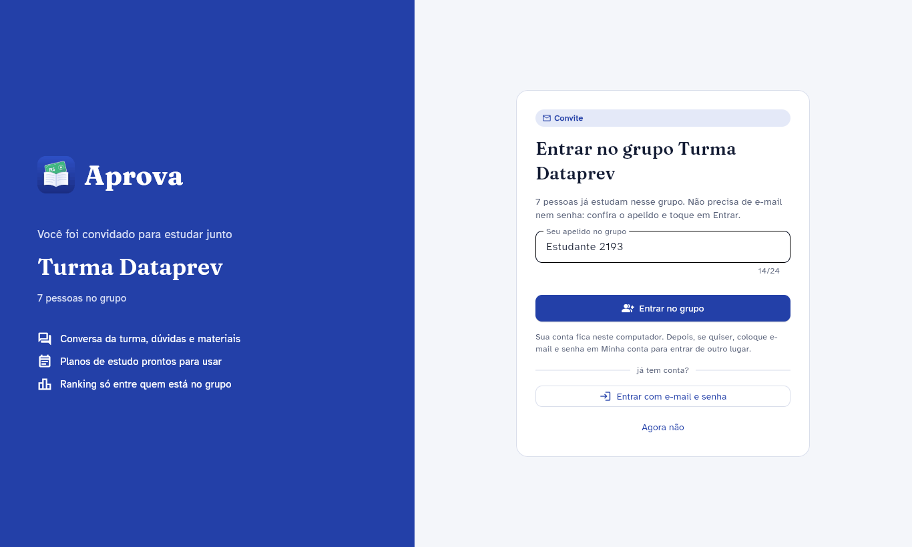<br><sub><b>Quem recebe o convite:</b> confere o apelido e já entra no grupo.</sub></td>
  </tr>
  <tr>
    <td>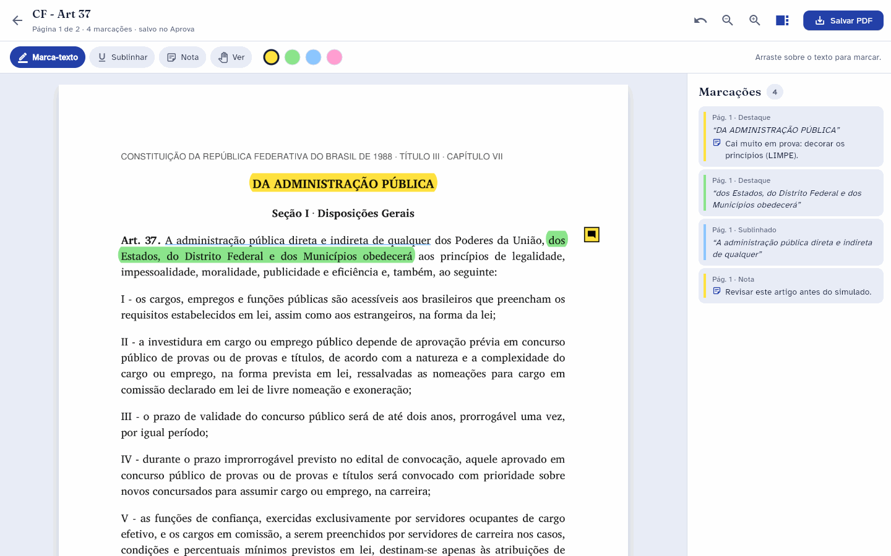<br><sub><b>Marcar PDF:</b> marca-texto, sublinhado e notas, com a lista ao lado.</sub></td>
    <td>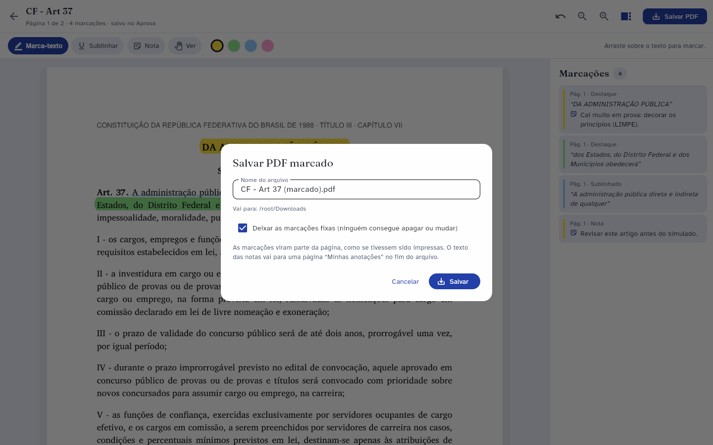<br><sub><b>Salvar PDF:</b> marcações editáveis ou fixas, num PDF novo.</sub></td>
  </tr>
  <tr>
    <td>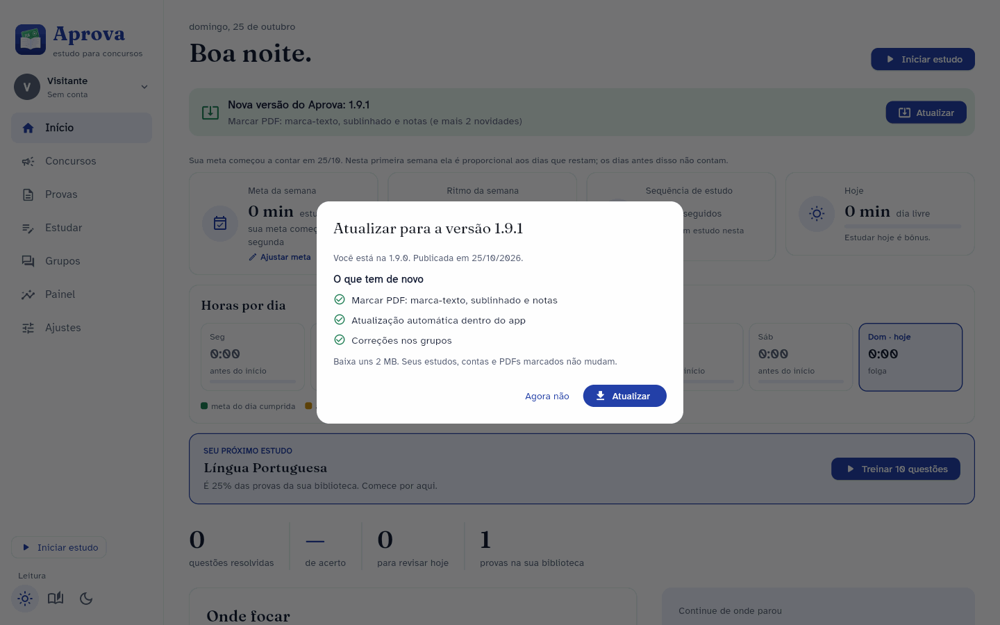<br><sub><b>Atualização:</b> o app avisa a versão nova e atualiza com um toque.</sub></td>
    <td>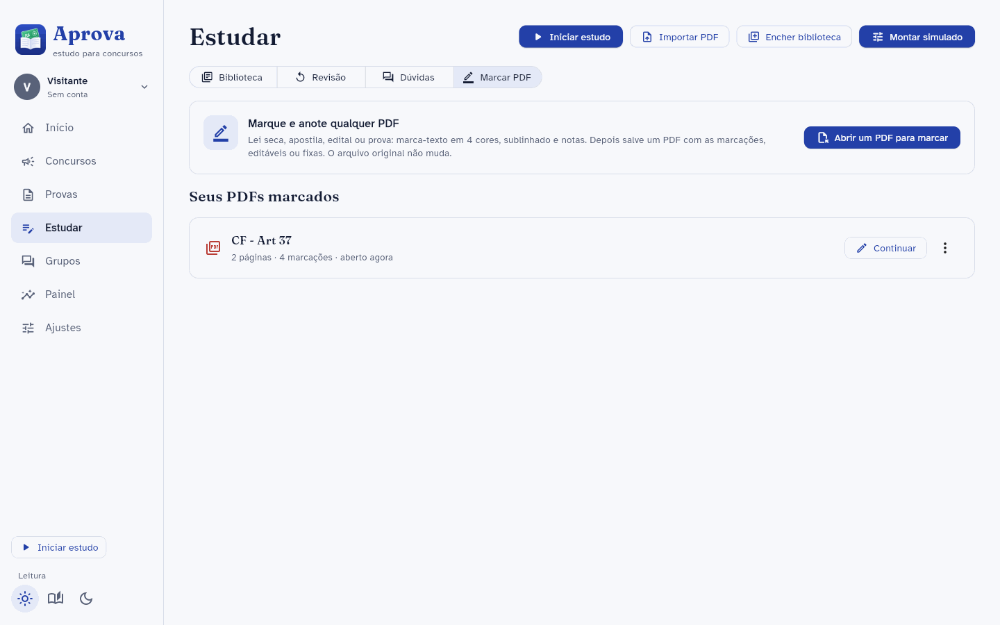<br><sub><b>Seus PDFs marcados:</b> continue de onde parou.</sub></td>
  </tr>
  <tr>
    <td>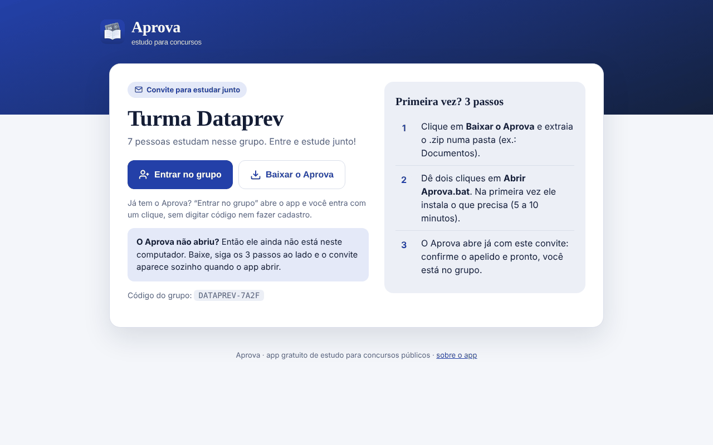<br><sub><b>Página do convite:</b> o link abre o app ou leva ao download.</sub></td>
    <td>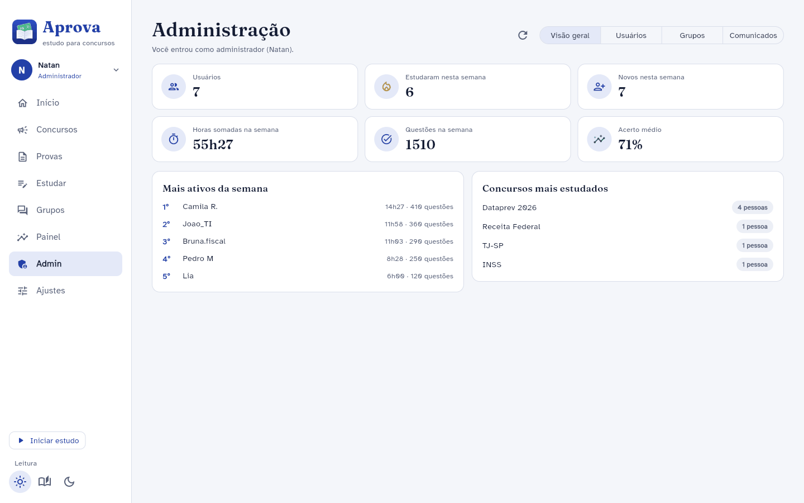<br><sub><b>Administração:</b> usuários, grupos e comunicados para todos.</sub></td>
  </tr>
</table>

<p align="center">
  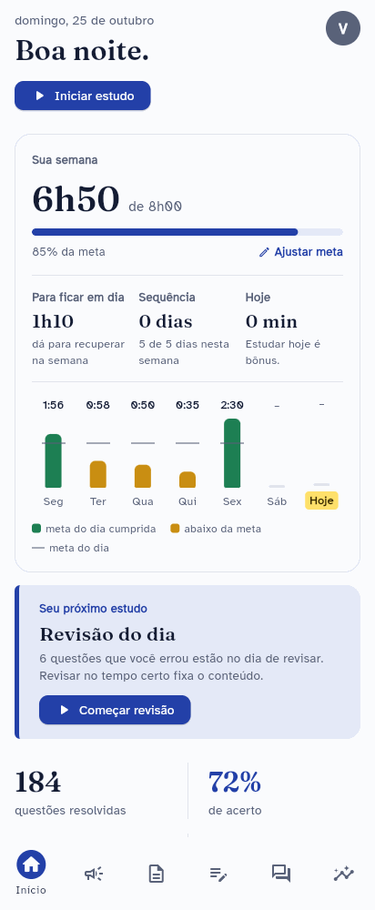
  &nbsp;&nbsp;
  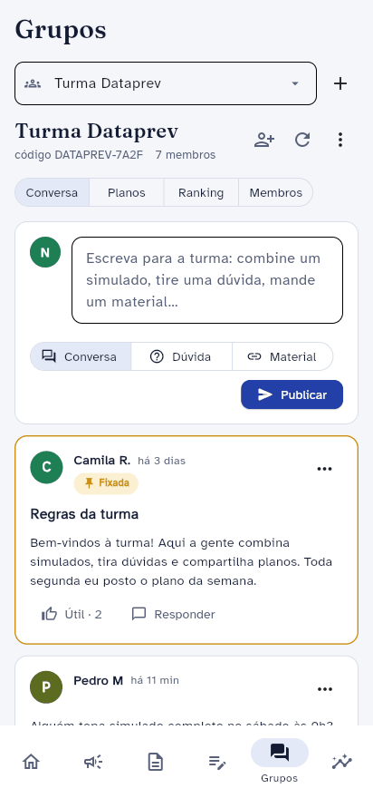
  &nbsp;&nbsp;
  
  <br>
  <sub>A tela se ajusta ao tamanho da janela e também abre no navegador do celular, na mesma rede Wi-Fi. À direita, a imagem de convite para Stories e TikTok.</sub>
</p>

## Como instalar no Windows

1. **[Baixe o Aprova](https://github.com/NatanaelSantz/aprova/releases/latest/download/Aprova.zip)** e extraia o .zip numa pasta (ex.: `Documentos\Aprova`).
2. Dê dois cliques em **`Abrir Aprova.bat`**. Na primeira vez abre a janela *Preparando o Aprova*: se faltar o Python, ele é instalado, e depois vêm as bibliotecas do app (de 5 a 10 minutos, com internet).
3. Pronto: o Aprova abre sozinho e cria o atalho **Aprova** na área de trabalho. Dali em diante, abra por ele.

> [!NOTE]
> **Atualizações:** da versão 1.9 em diante, o Aprova procura versão nova sozinho e mostra o aviso **Nova versão** no Início: é só tocar em **Atualizar** e depois em **Reiniciar agora**. Quem tem a 1.8 ou anterior precisa baixar o .zip uma última vez e extrair por cima da pasta antiga (os estudos ficam guardados à parte, na pasta `.aprova`).

> [!TIP]
> Recebeu um **convite de grupo**? Abra o link no computador e clique em **Entrar no grupo**. Se o Aprova ainda não estiver instalado, a página leva ao download e o convite aparece sozinho quando o app abrir.

No macOS e no Linux: `./iniciar.sh` (ou `./iniciar.sh --web` para abrir no navegador).

## Contas: aluno e administrador

| | Sem conta | Aluno | Administrador |
|---|:---:|:---:|:---:|
| Provas, simulados, metas, revisão e painel | ✅ | ✅ | ✅ |
| Grupos, planos de estudo e ranking | | ✅ | ✅ |
| Comunicados na tela Início | | ✅ | ✅ |
| Usuários, bloqueio, grupos e comunicados (tela **Admin**) | | | ✅ |

- A **primeira conta criada** no servidor vira administrador sozinha. Depois disso, só um administrador transforma outra conta em administrador.
- Quem chega por um convite pode entrar com uma **conta rápida** (só o apelido). Ela fica naquele computador até a pessoa colocar e-mail e senha em *Minha conta → Proteger minha conta*. Conta rápida nunca vira administrador.
- Cada conta tem os **próprios estudos**, então duas pessoas podem usar o mesmo computador.

## Privacidade

- Seus estudos (provas, respostas, metas, tempo e PDFs marcados) ficam **no seu computador**, na pasta `.aprova` da sua pasta de usuário.
- No servidor vão só o **apelido**, o concurso, os **números da semana** e o que você escreve nos grupos. O e-mail nunca aparece para ninguém e a senha não fica no computador.
- As regras de acesso ficam no próprio servidor ([`supabase/ranking.sql`](supabase/ranking.sql)): só quem está no grupo lê as mensagens dele, e um aluno não consegue se promover, mesmo mexendo no app.
- Em *Minha conta* dá para **apagar a conta** e todos os dados do servidor.

## Guia completo

O passo a passo de cada função (busca de provas, encher a biblioteca, montar simulado, lembretes, ranking, grupos, convite, chave do Claude, uso no celular e limites) está no **[Guia completo](docs/MANUAL.md)**.

<details>
<summary><b>Para quem mantém o app: servidor grátis no Supabase</b></summary>

<br>

Contas, ranking, grupos e convites usam um projeto do [Supabase](https://supabase.com) no plano grátis. O endereço e a chave pública do servidor oficial vêm em [`aprova/servidor.json`](aprova/servidor.json), então quem baixa o app já entra nele. Para usar um servidor seu:

1. Crie um projeto **Free** no Supabase.
2. Em **SQL Editor**, cole todo o [`supabase/ranking.sql`](supabase/ranking.sql) e clique em **Run**. Pode rodar de novo a cada versão: ele acrescenta o que falta sem apagar nada.
3. Em **Authentication → Sign In / Providers**: desligue **Confirm email** e ligue **Allow anonymous sign-ins** e **Allow manual linking** (conta rápida dos convites).
4. No botão **Connect** (ou **Settings → API Keys**), copie a **Project URL** e a chave **publishable**.
5. No Aprova, na tela de entrada: **Ligar as contas online**, cole os dois e salve (cria o `ranking.json`, que vale mais que o `servidor.json`).
6. Crie a sua conta primeiro: ela vira a de administrador.

Nunca coloque no app a chave **secret** / **service_role** (o Aprova recusa).

Fotos e arquivos dos grupos ficam no **Storage** do mesmo projeto, numa pasta privada chamada `anexos` (criada pelo próprio `ranking.sql`, com as regras de acesso). As fotos de perfil ficam na pasta privada `avatares` (uma por pessoa, em WebP pequeno); o personagem é só uma lista curta de escolhas guardada no perfil. A busca de GIFs usa o GIPHY: o administrador cola a chave grátis em **Admin → Configurações**.

A página do convite e a página do app ficam em [`docs/`](docs) e são publicadas pelo **GitHub Pages** (branch `main`, pasta `/docs`).

</details>

<details>
<summary><b>Para quem mantém o app: mandar uma atualização para todo mundo</b></summary>

<br>

1. Faça as mudanças e rode os testes (`python -m pytest -q tests`).
2. `python ferramentas/nova_versao.py 1.9.1 "O que mudou" "Outra novidade"`: muda o número da versão e escreve o [`docs/versao.json`](docs/versao.json), que é o que o app consulta.
3. `git commit -am "Versão 1.9.1"` e `git push` na `main`.

O robô [`publicar.yml`](.github/workflows/publicar.yml) cria a etiqueta `v1.9.1` e a [página da versão](https://github.com/NatanaelSantz/aprova/releases) com o `Aprova.zip`. O `versao.json` aponta para o .zip dessa etiqueta: o que for para a `main` depois (testes, rascunhos) só chega às pessoas na versão seguinte. O botão de baixar do site e deste README sempre leva à última versão publicada.

Em até 12 horas (ou na hora, em *Ajustes → Atualizações → Procurar atualização*), quem tem o Aprova vê o aviso no Início. O app baixa o .zip da versão, confere se ela é mesmo mais nova e deixa tudo pronto; a troca dos arquivos acontece ao reabrir, pelo `iniciar.pyw`, que guarda uma cópia da versão anterior em `.aprova/atualizacao/anterior` e só reinstala bibliotecas se o `requirements.txt` mudou. O `ranking.json` e a pasta `.venv` nunca são trocados.

**Se a versão nova não abrir** (erro ao abrir, ou duas aberturas sem a janela aparecer), o `iniciar.pyw` devolve os arquivos da versão anterior, abre ela e pula a versão com problema até sair uma mais nova. Fica anotado em `.aprova/instalacao.log`.

**Robôs do GitHub:** [`testes.yml`](.github/workflows/testes.yml) roda os testes no Windows a cada envio; [`vigias.yml`](.github/workflows/vigias.yml) roda todo dia, mantém o Supabase acordado (o plano grátis pausa depois de 7 dias sem uso) e confere se o app ainda lê o PCI e a FGV ([`ferramentas/conferir_sites.py`](ferramentas/conferir_sites.py)). Quando um deles falha, o GitHub manda e-mail.

</details>

<details>
<summary><b>Para desenvolver</b></summary>

<br>

```
aprova/
  ui/             telas em Flet (início, provas, estudar, grupos, painel, admin, login…)
  db.py           banco SQLite local de cada conta
  ranking.py      cliente do servidor (login, papéis, ranking, grupos, fórum, convites)
  convite.py      link de convite, endereço aprova://, imagem com QR code
  marcador.py     marcar PDF: destaque, sublinhado, notas e salvar (editável ou fixo)
  atualizar.py    atualização automática (versao.json, download e troca ao reabrir)
  fontes.py       busca central: sites das bancas, internet e PCI
  coleta.py       "Encher a biblioteca": provas de um concurso em lote
  pdfprova.py     texto, questões e gabarito dos PDFs
  analise.py      números do Painel e da meta da semana
  sessoes.py      revisão espaçada e "próximo estudo"
  ia.py           recursos opcionais com a API do Claude
supabase/         ranking.sql: tabelas, papéis e regras de acesso do servidor
docs/             site no GitHub Pages (página do app, do convite, versao.json) e o guia completo
ferramentas/      nova_versao.py (publicar atualização), conferir_sites.py, abertura e instalação do Python
iniciar.pyw       abre o app sem console e instala o que faltar
tests/            testes, servidor falso do Supabase e capturas de tela
```

```bash
python -m pip install -r requirements.txt
python main.py                      # abre o app
python -m pytest -q tests           # testes (sem internet)
python tests/servidor_falso.py 8788 # servidor falso com 6 pessoas e um grupo de exemplo
```

As regras do servidor também podem ser testadas num PostgreSQL de verdade:
`APROVA_PG="host=… port=… user=postgres dbname=postgres" python -m pytest tests/test_sql_supabase.py` (o banco é recriado do zero).

</details>

## Versões

| Versão | O que chegou |
|---|---|
| **1.25.0** | Riscar alternativas na questão (ícone, clique direito ou Shift + letra); **Meu concurso** com contagem regressiva no Início, o Onde focar nas provas dele e o personagem lembrando os dias; **cópia de segurança** dos estudos (salvar, restaurar em outro computador e uma cópia automática por semana) |
| **1.24.0** | Atualização mais segura: cada versão vem de um .zip fixo (etiqueta no GitHub) e, se a versão nova não abrir, o app volta sozinho para a anterior; chave da IA e login cifrados no Windows; espaço usado no servidor no Admin; bibliotecas em versões fixas; robôs que testam no Windows, mantêm o servidor acordado e conferem os sites todo dia |
| **1.23.0** | App para Android (APK, o mesmo app instalado no celular) e build do iPhone funcionando no simulador; no celular, pasta de dados do app, Compartilhar e alarme que vibra |
| **1.22.0** | O personagem fala com você (frases motivacionais, engraçadas, dicas, lembretes do dia e as suas, com o seu nome) e dança; Admin → Personagens com a galeria de todo mundo |
| **1.21.1** | Início sem espaço sobrando (personagem do lado da saudação, barras da semana baixinhas sem estudo), abas do personagem numa linha; vídeo tutorial atualizado |
| **1.21.0** | Telas largas sem espaço sobrando: Ajustes em duas colunas, resultado lado a lado, questão centralizada e sala da turma na largura do cartão; vídeo tutorial atualizado |
| **1.20.0** | Cabelos novos: calvo (sem cabelo no alto da cabeça, com cabelo dos lados) e com entradas |
| **1.19.1** | Barba e bigode acompanham a boca: bigode com as pontas para cima e barba contornando o sorriso |
| **1.19.0** | Pixel art com sombreamento de jogo (luz quente, sombra fria, contorno seletivo) e cenários redesenhados com luz e partículas animadas; vídeo tutorial com a arte nova |
| **1.18.0** | Personagens com olhos grandes e mais detalhes, 4 cores de olhos novas; figurinha e GIF vão para a prévia da mensagem antes de enviar |
| **1.17.0** | Tipo de corpo do personagem (magro, médio, forte, gordinho; médio por padrão), barba, boca, detalhes do rosto, 5 cabelos, 5 roupas e 4 itens novos, cor da calça |
| **1.16.1** | Figurinhas na conversa: mensagem compacta e sem moldura, aparece na hora ao mandar, aba Recentes e abas visíveis no celular |
| **1.16.0** | Mini prova por disciplina no Onde focar: escolha a disciplina, a prova de origem, quantas questões e se é com cronômetro |
| **1.15.0** | Personagens com o dobro de detalhe, 7 modelos de óculos com 8 cores e 14 acessórios novos (cabeça, pescoço e costas) |
| **1.14.1** | Corrige o erro de certificado (CERTIFICATE_VERIFY_FAILED) na primeira abertura em computadores com antivírus que inspeciona a internet, rede de escola ou Windows novo |
| **1.14.0** | Personagem estilo RPG (pixel art animado) ou foto de perfil, com a sala da turma nos grupos, o boneco no Início e a comemoração no resultado |
| **1.13.1** | Atualiza sozinho ao abrir (e baixa a versão nova em segundo plano com o app aberto) |
| **1.13.0** | Perguntar ao Claude ou ao ChatGPT (abre o chat com a questão ou os erros do simulado, sem chave) e passo a passo para conseguir a chave da IA |
| **1.12.0** | Simulados sem repetição e sem questão quebrada, resultado comentado por matéria, aviso de atualização por notificação e reforço de segurança (grupos só com convite, arquivos perigosos bloqueados, acesso pelo celular com código) |
| **1.11.0** | Minhas figurinhas: importe as do WhatsApp (arquivos, pacotes .wastickers/.zip ou Ctrl+V) e guarde as que chegam no grupo |
| **1.10.0** | Fotos, arquivos, GIFs e figurinhas nos grupos (figurinhas próprias do Aprova; GIFs pelo GIPHY) |
| 1.9.5 | Tamanho da interface (zoom automático em telas com zoom do Windows, Ctrl + e Ctrl −) e barra de rolagem nova |
| 1.9.4 | Barra de cima do Windows com as cores do tema do Aprova |
| 1.9.3 | Menu que cabe em notebooks com zoom, janela que cabe na tela e abre em tela cheia |
| 1.9.2 | Retirada: a barra de cima própria impedia o app de abrir no Windows |
| 1.9.1 | Visual novo (navegação em bolinhas do cartão-resposta, painel "Sua semana") e layout mais ajustável |
| 1.9.0 | Marcar PDF (marca-texto, sublinhado, notas, salvar editável ou fixo) e atualização automática |
| 1.8.0 | Convite por link (WhatsApp, Instagram, TikTok), página do convite, entrada sem cadastro |
| 1.7.0 | Grupos de estudo com fórum, planos de estudo compartilhados e moderação |
| 1.6.0 | Tela de login, conta de aluno e de administrador, comunicados, layout em 3 tamanhos |
| 1.5.1 | Base: provas, simulados, metas, revisão, painel e ranking |

Cada versão tem a sua etiqueta no Git (`git tag`).

---

<p align="center">
  Feito por <a href="https://github.com/NatanaelSantz">Natanael Santos</a>, para quem estuda para concursos públicos no Brasil.<br>
  <sub>As provas e os gabaritos pertencem às bancas organizadoras; o Aprova só ajuda a encontrá-los e a estudar por eles.</sub>
</p>
